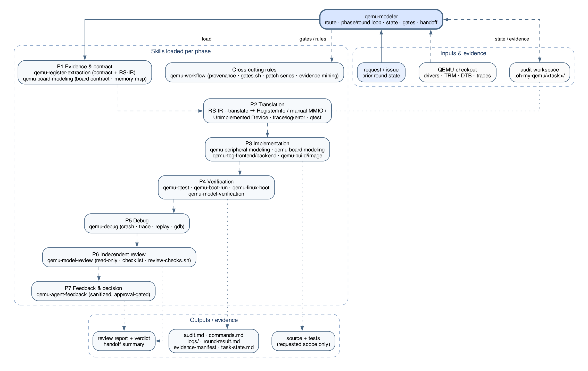

# Architecture

> [中文](architecture.md) · **English**

This document describes the current Oh My QEMU layered architecture, execution
owner, data flow, and hard boundaries. See
[modeling-workflow.md](modeling-workflow.md) for the flow and
[rs-ir-and-translation.md](rs-ir-and-translation.md) for RS-IR details.

## Overview



The system has six layers:

1. **Top-level orchestration** — `qemu-modeler` is the single entry. It routes
   domain skills, advances phases, records state, runs gates, and hands off.
2. **Domain modeling** — `qemu-register-extraction` produces the contract and
   RS-IR; `qemu-peripheral-modeling`, `qemu-board-modeling`, and
   `qemu-tcg-frontend` / `qemu-tcg-backend` implement the model.
3. **Build, image, and boot** — `qemu-build`, `qemu-kernel-build`,
   `qemu-uboot-build`, `qemu-image`, `qemu-boot-run`, and
   `qemu-linux-boot` produce and boot real inputs.
4. **Verification** — `qemu-qtest`, `qemu-model-verification`, and
   `qemu-debug`.
5. **Review and feedback** — `qemu-model-review` performs independent review;
   `qemu-agent-feedback` drafts sanitized, approval-gated workflow feedback.
6. **Cross-cutting rules** — `qemu-workflow` supplies provenance, planning,
   iteration, gates, patch series, and evidence mining.

## Top-level entry: qemu-modeler

`qemu-modeler` does not replace domain skills. It decides **which skills to load,
in what order, and what counts as done**:

- **Phases**: P0 intake -> P1 evidence & contract -> P2 translation ->
  P3 implementation -> P4 build & test -> P5 debug -> P6 independent review ->
  P7 feedback & decision -> P8 handoff.
- **Rounds**: one round advances one objective; every round has an objective, a
  gate, evidence, a review, and a decision.
- **State**: `output/task-state.md`, `output/rounds.tsv`, and
  `output/findings.tsv`; maintained by `scripts/loop-state.sh`.
- **Gates**: reuse `qemu-workflow`'s `gates.sh` when installed; a missing skill
  is recorded as a gap, never imitated.
- **Stop**: all ACs pass, scope complete, external input/authority missing,
  explicit user stop, or continuing would cross the provenance boundary. A round
  budget is a design checkpoint, not a stop condition.

## Data flow

```text
request / prior state
        │
        ▼
  qemu-modeler (routing + phases/rounds)
        │
        ├── evidence ──► register-contract.md + register-semantics.ir
        │                    │
        │                    ▼
        │              RS-IR --translate
        │                    │
        │                    ├── RegisterInfo / hooks (peripheral behavior)
        │                    ├── manual MMIO / helper
        │                    ├── Unimplemented Device (board placeholder)
        │                    └── observe: trace / LOG_UNIMP / LOG_GUEST_ERROR / error
        │                    │
        │                    ▼
        │              qtest / boot marker / workload evidence
        │                    │
        │                    ▼
        │              qemu-model-review (independent)
        │                    │
        │                    ▼
        └──────── decision: next round / handoff / stop
```

All artifacts and evidence go under `.oh-my-qemu/<task-slug>/`; QEMU builds go
under `builds/build-<target>/`.

## RS-IR to QEMU mechanisms

| RS-IR input | QEMU mechanism |
| --- | --- |
| `framework registerinfo` + trigger/hook | `RegisterInfo` / `RegisterAccessInfo` access type and pre/post hook |
| `framework manual-mmio` / `helper` | explicit `MemoryRegionOps` callback or helper |
| condition predicate | callback guard / pre-write filter |
| transition operations | post-write/post-read hook, IRQ, timer, FIFO, DMA, exception |
| `observe trace=...` | device trace event, correlated with qtest/runtime evidence |
| `observe log=unimp` | `LOG_UNIMP` on unimplemented paths |
| `observe error=guest_error` | `LOG_GUEST_ERROR` on invalid guest access |
| `symbol address ... status=unimplemented placeholder=...` | board-level Unimplemented Device placeholder, removed when the real device lands |
| rule id | model comment / trace event / qtest name for traceability |

See [rs-ir-and-translation.md](rs-ir-and-translation.md) and
`skills/qemu-peripheral-modeling/references/ir-to-registerinfo.md`,
`skills/qemu-board-modeling/references/unimplemented-device.md`.

## Audit workspace and gates

```text
.oh-my-qemu/<task-slug>/
├── audit.md              # baseline, plan, decisions, evidence, gaps
├── commands.md           # redacted commands, working directories, results
├── logs/                 # decisive build/test/runtime output
├── scripts/              # temporary probes, parsers, harnesses
└── output/               # generated deliverables, dependencies, non-QEMU binaries
```

- **QEMU builds**: only `builds/build-<target>/`; never an unqualified `build/`.
- **RS-IR**: `output/register-semantics.ir` + `output/register-contract.md`;
  validator: `skills/qemu-register-extraction/scripts/validate_register_ir.py`.
- **State/rounds**: `output/task-state.md`, `output/rounds.tsv`,
  `output/round-result.md`.
- **Gate scripts**:
  - `skills/qemu-workflow/scripts/gates.sh`: workspace, audit-sections,
    round-result, evidence-manifest, git-status, build-dir, marker, handoff.
  - `skills/qemu-model-review/scripts/review-checks.sh`: deterministic review-packet checks.
  - `skills/qemu-modeler/scripts/loop-state.sh`: state and round records.

## Portability and upstream boundary

- Every skill is independently installable; it does not depend on another skill,
  a repository script, or a runtime plugin.
- When a skill is missing, `qemu-modeler` records a `missing skill` gap and uses
  the nearest available rules instead of pretending to load it.
- This repository and its docs support **local modeling, research, debugging, and
  verification only**. They do not prepare or send QEMU upstream code,
  documentation, commit messages, or patches. Upstream submission is handled by
  humans under `docs/devel/code-provenance.rst`.

## Evolution

- The complete 19-skill catalog is under `skills/`; each `SKILL.md` is the rule
  source of truth.
- To add or change a skill: update the skill first, then these architecture/workflow
  docs and the Graphviz sources.
- Next planned step: continuously mine the upstream mailing list for modeling and
  review requirements, extending the PM/BM/RV catalogs in
  `qemu-peripheral-modeling/references/field-lessons.md` and
  `qemu-board-modeling/references/field-lessons.md`.
