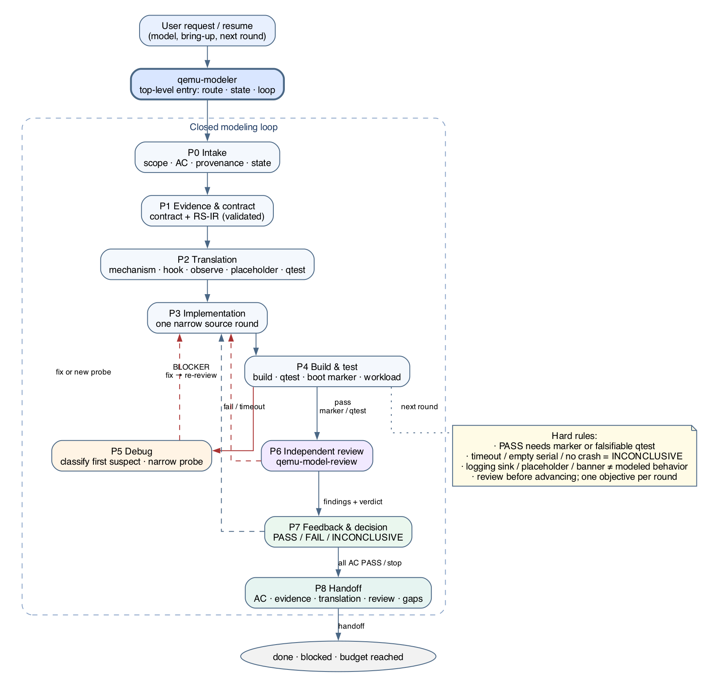

# Modeling Workflow

> [中文](modeling-workflow.md) · **English**

This document describes the end-to-end modeling workflow driven by
**qemu-modeler**: from a user request through evidence, RS-IR translation,
implementation, build/test, debug, independent review, and decision, until
handoff or the next round.



## Entry

- For "model <device/board>", "bring up", or "continue the next round", start
  with `qemu-modeler`.
- For a single-purpose task, load a domain skill directly; `qemu-workflow` still
  provides cross-cutting rules.
- If a named/required skill is not installed, record
  `missing skill: <name>` in `audit.md` and use the nearest available rules.
  Never invent or impersonate the missing skill.

## Goal mode: finish the goal, not the round

A complex QEMU modeling task is not complete because Round 0/1/2 ran. The default
qemu-modeler mode is **goal mode**:

| Level | Question | Requirement |
| --- | --- | --- |
| Goal | What end state does the user need? | observable outcome, not "finish N rounds" |
| Milestone | Which checkpoint unlocks the next stage? | 2-5, each with an exit gate; not a task list |
| Acceptance criterion | Which falsifiable fact proves a goal promise? | evidence-bound (qtest/marker/trace/log) |
| Round | What is the smallest step now? | one objective; it must name an AC |

Completion is **goal-level**: every AC has evidence-backed PASS, every milestone
is done, and no BLOCKER remains. Only then does loop-state.sh loop print
"PASS goal complete". Otherwise it prints "CONTINUE"; the agent keeps starting
rounds instead of pausing to ask whether to continue.

<pre>
loop-state.sh goal &lt;task&gt; "&lt;goal&gt;" goal
loop-state.sh milestone add &lt;task&gt; M1 "&lt;checkpoint&gt;"
loop-state.sh ac add &lt;task&gt; AC1 "&lt;observable outcome&gt;"
loop-state.sh ac status &lt;task&gt; AC1 pass "&lt;evidence&gt;"
loop-state.sh milestone status &lt;task&gt; M1 done "&lt;exit-gate-evidence&gt;"
loop-state.sh loop &lt;task&gt;          # CONTINUE or PASS goal complete
loop-state.sh finding resolve &lt;task&gt; F-01   # unblock after fix + re-review
</pre>

A milestone `done` requires exit-gate evidence. Changing an AC, milestone,
evidence, or blocker finding resets review status, so record a fresh review
verdict afterward.
In round mode, `loop` only accepts the requested round's own round-result with a
valid verdict, gate, evidence, and a recorded review verdict (a baseline prevents
a historical result from triggering handoff). Review checks default to the intermediate
contract; use `review-checks.sh --final-goal` only for a goal-completion claim.

A round budget is a design checkpoint, not a stop condition: summarize what is
proven and open, replan the next 1-3 rounds, and continue. Stop only when all
ACs are evidenced and all milestones are evidence-backed done, scope is complete,
external input/authority is missing, the user explicitly stops, or provenance
would be violated.

## Phases P0-P8

| Phase | Goal | Key actions | Exit |
| --- | --- | --- | --- |
| P0 Intake | Freeze the task and goal contract | Classify task, scope, ACs, provenance intent, allowed paths, stop condition; read prior state | `audit.md` baseline/goal/milestones/AC/stop recorded |
| P1 Evidence & contract | Source-cited facts | Read driver/TRM/SVD/DTB/trace; extract register/board/boot facts; produce `register-contract.md` + `register-semantics.ir` | Contract exists; unknowns/conflicts visible; RS-IR validates |
| P2 Translation | Turn contract into an implementation worklist | `--translate` to mechanism/hook/observe/placeholder/qtest; choose RegisterInfo/manual MMIO/Unimplemented Device, trace/log/error | Every rule has mechanism+hook+qtest; guest-visible has observe; unimplemented has placeholder |
| P3 Implementation | Advance one narrow objective | Domain skill implements one coherent change within requested scope; update audit/commands | Source change complete; no unrelated changes; test plan ready |
| P4 Build & test | Produce decidable evidence | Named build, narrow qtest, boot marker, workload; capture decisive logs | Gate result, command, log path recorded |
| P5 Debug | Localize the first blocker | Classify: environment/stale input/command or ABI/topology/device semantics/TCG/guest; use qemu-debug if needed | First suspect and next narrow check named |
| P6 Independent review | Prevent self-approval | qemu-model-review reads the packet and returns findings + verdict | Verdict/findings recorded; BLOCKERs listed |
| P7 Feedback & decision | Decide next action | Fix blockers, re-review, capture reusable feedback, continue/replan/stop | Next action recorded; AC status updated |
| P8 Handoff | Finish reproducibly | Summarize ACs, evidence, translation, review, source changes, gaps, next action | Handoff complete; no hidden blocker |

## RegisterInfo framework decision

Guest-visible control/status banks default to **RegisterInfo**. Manual MMIO is
reserved for command/FIFO/DMA/timing/reentrancy structures that RegisterInfo
hooks cannot express without distortion, or for a hybrid split (control/status
on RegisterInfo, data/command aperture on MemoryRegionOps).

- "Neighboring devices use manual MMIO" is not sufficient: the convention must
  be same-subsystem, maintained, semantically comparable, and cited by file:line.
- Time, budget, register count, and "every register has a side effect" are not
  decisive inputs.
- Record the decision in output/framework-decision.md with bank kind, decisive
  input, structural reason, hybrid split, and accepted limits; a missing or
  vague record is a review BLOCKER.
- Run check-framework-decision.sh from qemu-peripheral-modeling before review.

## Source comment hygiene

Keep QEMU file headers minimal: SPDX/copyright plus at most a one-line hardware
identity. Body comments describe hardware behavior and public manual/repository
references only. Do not put task artifacts or design rationale into source:

- no implementation strategy, framework choice/defense, "modeled contract"
  pointer, or neighboring-convention rationale;
- no `.oh-my-qemu/...`, `output/...`, `audit.md`, evidence paths, round/review
  IDs, or absolute host paths;
- no "contract is output/register-contracts-r2.md" task-local references;
- keep evidence and provenance in audit/contract/output; source comments must
  stand on their own outside the local workspace;
- review leaked local paths as blockers; when qemu-workflow is installed, run
  `gates.sh source-comments <files...>` on changed source.

## The round loop

A round = one objective + one gate + one independent review + one decision.
A round is a progress unit, not the goal; completion is checked at goal level.

### 1. Write the objective

Before editing, write the smallest objective in `audit.md`: which AC it advances
or which failure class it eliminates. Do not mix unrelated cleanup or
cross-stage blockers into one round.

### 2. Execute and gate

- Minimal reversible change or diagnostic probe.
- Named build directory `builds/build-<target>/`.
- Narrowest gate: target build -> qtest -> boot marker -> workload.
- Record exact command, exit/process status, marker status, and log path.
- PASS comes only from a configured marker or falsifiable qtest; timeout, empty
  serial log, or "no crash" is INCONCLUSIVE.

### 3. Write the round result

```text
Round: <n>
Objective: <one objective>
Verdict: PASS | FAIL | INCONCLUSIVE
Gate: <marker/test/command + expected value>
Evidence: logs/..., output/..., tests/...
Changed paths: <task-owned paths>
Commands: <effective commands>
Findings: <review ID or none>
Next blocker: <concrete next action or none>
```

### 4. Independent review

- Packet: plan/ACs, exact diff, contract/RS-IR/translation, commands/logs/tests,
  round result.
- Reviewer is read-only and returns BLOCKER/MAJOR/MINOR/NOTE plus
  PASS/FAIL/INCONCLUSIVE.
- An intermediate-round PASS needs evidence for the round objective/gate and no
  blocker for that round; later ACs/milestones may remain pending. A final-goal
  PASS additionally needs every AC evidenced and every milestone evidence-backed
  done, via `review-checks.sh --final-goal`. INCONCLUSIVE must name the missing
  evidence and the next narrow command.

### 5. Decide

| Situation | Next action |
| --- | --- |
| All ACs have evidence | Run loop-state.sh loop; hand off only on PASS goal complete, otherwise continue with the next AC/round |
| Objective met, goal not yet | Plan the next narrow objective and start the next round automatically |
| One blocker | Stay in the round; fix and rerun the gate |
| Insufficient evidence | Add probe/qtest/trace; do not change model behavior first |
| Two independent blockers / new stage | Replan, split rounds, update plan/state, continue the goal loop |
| External input/authority missing | Stop and state the blocked condition |
| Budget/checkpoint reached | Summarize proven/open work, replan 1-3 rounds, continue; never call it complete |
| User explicitly stops | Hand off; mark user-stopped, not goal-complete |

## Debug entry

Classify before changing the model:

1. wrong/stale input (image, DTB, firmware, kernel, rootfs);
2. command, machine option, or boot ABI mismatch;
3. host/toolchain/build directory;
4. board topology / IRQ wiring;
5. device register/IRQ/timer/DMA semantics;
6. TCG frontend/backend;
7. guest/rootfs/application.

A debug session is not PASS evidence by itself; return to P4 with a named gate.

## Stop and handoff

Stop only when:

- all ACs have fresh evidence-backed PASS, all milestones are evidence-backed done, review status is PASS, and the latest verdict belongs to the current round and is PASS (goal complete);
- requested scope is complete and the user confirms handoff;
- external input/authority is missing (record as blocked);
- the user explicitly stops;
- continuing would violate the provenance boundary.

A round budget, a failed round, or a long log is not a stop condition: replan and
continue. Completion is goal-level, not round-level.

Handoff: task/build directories, goal and AC status, milestone status,
translation mapping, review verdict/findings, evidence paths, source changes,
pre-existing changes, policy limits, unresolved gaps. An INCONCLUSIVE handoff
must name the missing evidence and the next narrow command; it is not goal
completion.

## Hard rules

- PASS needs a marker or a falsifiable qtest.
- Timeout, empty serial log, or "no crash" is not PASS.
- A logging sink, unimplemented placeholder, or boot banner is not modeled
  behavior.
- Review before advancing; one objective per round.
- A round count or budget is not goal completion. Continue the goal loop while
  `loop-state.sh loop` prints CONTINUE; stop only on PASS goal complete or a real
  stop condition.
- Do not commit or push unless the user explicitly requests it.
- Local-only work must not accidentally become upstream-ready.

## Commands

```bash
# task state / goal loop
bash skills/qemu-modeler/scripts/loop-state.sh init .oh-my-qemu/<task-slug>
bash skills/qemu-modeler/scripts/loop-state.sh goal .oh-my-qemu/<task-slug> "<goal>" goal
bash skills/qemu-modeler/scripts/loop-state.sh milestone add .oh-my-qemu/<task-slug> M1 "<checkpoint>"
bash skills/qemu-modeler/scripts/loop-state.sh ac add .oh-my-qemu/<task-slug> AC1 "<observable outcome>"
bash skills/qemu-modeler/scripts/loop-state.sh loop .oh-my-qemu/<task-slug>
bash skills/qemu-modeler/scripts/loop-state.sh show .oh-my-qemu/<task-slug>

# RS-IR
python3 skills/qemu-register-extraction/scripts/validate_register_ir.py \
    .oh-my-qemu/<task-slug>/output/register-semantics.ir
python3 skills/qemu-register-extraction/scripts/validate_register_ir.py --translate \
    .oh-my-qemu/<task-slug>/output/register-semantics.ir

# workspace/round/handoff gates (when qemu-workflow is installed)
bash skills/qemu-workflow/scripts/gates.sh all .oh-my-qemu/<task-slug>

# deterministic review-packet checks
bash skills/qemu-model-review/scripts/review-checks.sh \
    --task-dir .oh-my-qemu/<task-slug> \
    --ir .oh-my-qemu/<task-slug>/output/register-semantics.ir \
    --validator skills/qemu-register-extraction/scripts/validate_register_ir.py
```

## Fictional example (demo timer)

1. **P0**: "Model a demo timer; acceptance is that the periodic interrupt fires."
2. **P1**: Extract CTRL/EN/MODE, PERIOD, counter, irq0 from driver/TRM; produce
   contract + RS-IR.
3. **P2**: `--translate` gives R1 -> RegisterInfo/post_write and R2 -> manual
   timer callback. observe names `demo_timer.r1/r2`; UNMODELED_WINDOW is
   marked as board_unimpl placeholder.
4. **P3**: Implement CTRL and the timer callback; put the board-level
   Unimplemented Device placeholder in place.
5. **P4**: Build and qtest the write-to-schedule and expiry counter/IRQ behavior.
6. **P5**: If boot stalls, verify image/DTB/command first, then decide whether
   to change the model.
7. **P6**: Review finds R2 has no trace; BLOCKER.
8. **P7**: Add trace, re-review PASS; remove UNMODELED_WINDOW placeholder;
   enter P8.
9. **P8**: Hand off AC status, evidence paths, review result, and gaps.

## Related docs

- [architecture.md](architecture.md)
- [rs-ir-and-translation.md](rs-ir-and-translation.md)
- `skills/qemu-modeler/SKILL.md`, `skills/qemu-model-review/SKILL.md`
- `skills/qemu-peripheral-modeling/references/ir-to-registerinfo.md`
- `skills/qemu-board-modeling/references/unimplemented-device.md`
