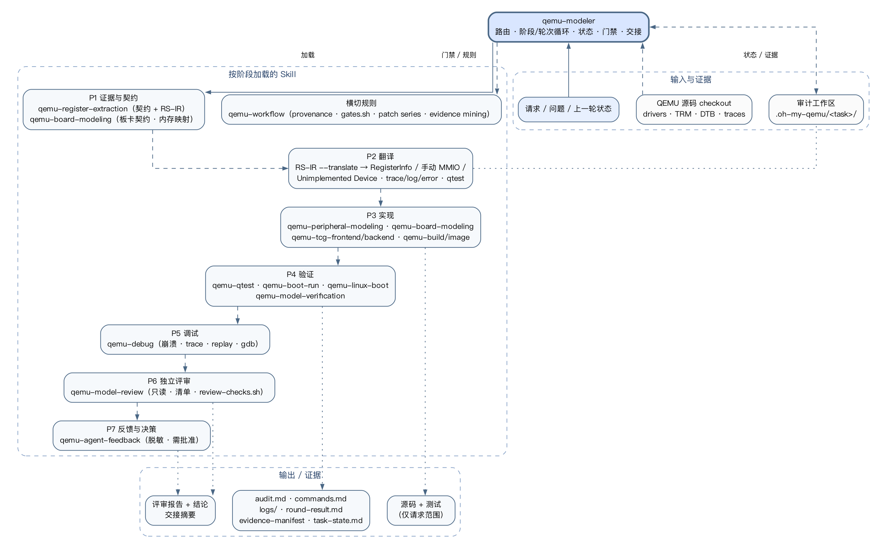

# 整体架构

> **中文** · [English](../en/architecture.md)

本文描述当前 Oh My QEMU 的分层架构、执行主体、数据流和硬边界。流程图见
[modeling-workflow.md](modeling-workflow.md)；RS-IR 细节见
[rs-ir-and-translation.md](rs-ir-and-translation.md)。

## 总览



整个系统可以分成六层：

1. **顶层编排层**：`qemu-modeler` 是唯一入口，负责路由、阶段推进、状态记录、
   门禁检查和交接。
2. **领域建模层**：`qemu-register-extraction` 产出契约与 RS-IR；
   `qemu-peripheral-modeling` / `qemu-board-modeling` / `qemu-tcg-*` 负责实施。
3. **构建/镜像/启动层**：`qemu-build`、`qemu-kernel-build`、
   `qemu-uboot-build`、`qemu-image`、`qemu-boot-run`、`qemu-linux-boot`
   负责产生并启动真实输入。
4. **验证层**：`qemu-qtest`、`qemu-model-verification`、`qemu-debug`。
5. **评审与反馈层**：`qemu-model-review` 做独立评审，`qemu-agent-feedback`
   负责可复用的流程改进提案（脱敏、需批准）。
6. **横切规则层**：`qemu-workflow` 提供 provenance、planning、iteration、
   gates、patch series、evidence mining 等跨领域规则。

## 顶层执行者：qemu-modeler

`qemu-modeler` 不替代领域 skill，而是决定**加载哪些、按什么顺序、什么算通过**：

- **阶段**：P0 任务受理 → P1 证据与契约 → P2 翻译 → P3 实现 →
  P4 构建与测试 → P5 调试 → P6 独立评审 → P7 反馈与决策 → P8 交接。
- **轮次**：一个轮次只推进一个目标；每轮都有目标、门禁、证据、评审和结论。
- **状态**：`output/task-state.md`、`output/rounds.tsv`、
  `output/findings.tsv`；由 `scripts/loop-state.sh` 维护。
- **门禁**：可复用 `qemu-workflow` 的 `gates.sh`；缺 skill 时记录 gap，
  不即兴复制规则。
- **停止**：验收全部通过、范围完成、外部输入/授权缺失、用户明确停止、
  或继续会越过 provenance 边界。轮次预算是设计检查点，不是停止条件。

## 数据流

```text
用户请求 / 上一轮状态
        │
        ▼
  qemu-modeler（路由 + 阶段/轮次）
        │
        ├── 证据 ──► register-contract.md + register-semantics.ir
        │              │
        │              ▼
        │        RS-IR --translate
        │              │
        │              ├── RegisterInfo / hooks（外设行为）
        │              ├── manual MMIO / helper
        │              ├── Unimplemented Device（板卡占位）
        │              └── observe：trace / LOG_UNIMP / LOG_GUEST_ERROR / error
        │              │
        │              ▼
        │        qtest / boot marker / workload 证据
        │              │
        │              ▼
        │        qemu-model-review（独立）
        │              │
        │              ▼
        └──────── 决策：下一轮 / 交接 / 停止
```

所有中间产物和证据写入 `.oh-my-qemu/<task-slug>/`；QEMU 自身构建写入
`builds/build-<target>/`。

## RS-IR 到 QEMU 机制的翻译

| RS-IR 输入 | QEMU 机制 |
| --- | --- |
| `framework registerinfo` + trigger/hook | `RegisterInfo` / `RegisterAccessInfo` 的 access type 与 pre/post hook |
| `framework manual-mmio` / `helper` | 显式 `MemoryRegionOps` 回调或 helper |
| 条件 predicate | 回调内的 guard / 预写过滤 |
| transition 操作 | post-write/post-read hook、IRQ、timer、FIFO、DMA、异常 |
| `observe trace=...` | 设备 trace-event；与 qtest/运行证据关联 |
| `observe log=unimp` | 未实现路径的 `LOG_UNIMP` |
| `observe error=guest_error` | 非法 guest 访问的 `LOG_GUEST_ERROR` |
| `symbol address ... status=unimplemented placeholder=...` | 板卡级 Unimplemented Device 占位；真实设备落地后移除 |
| 规则 id | 模型注释 / trace event / qtest 名，用于双向追溯 |

具体翻译约束见 [rs-ir-and-translation.md](rs-ir-and-translation.md) 和
`skills/qemu-peripheral-modeling/references/ir-to-registerinfo.md`、
`skills/qemu-board-modeling/references/unimplemented-device.md`。

## 审计工作区与门禁

```text
.oh-my-qemu/<task-slug>/
├── audit.md              # baseline、计划、决策、证据、缺口
├── commands.md           # 脱敏命令、工作目录、结果
├── logs/                 # 决定性构建/测试/运行日志
├── scripts/              # 临时探针、parser、harness
└── output/               # 生成物、依赖产物、非 QEMU 二进制
```

- **QEMU 构建**：只放 `builds/build-<target>/`，绝不使用未限定的 `build/`。
- **RS-IR**：`output/register-semantics.ir` + `output/register-contract.md`；
  validator 位于 `skills/qemu-register-extraction/scripts/validate_register_ir.py`。
- **状态/轮次**：`output/task-state.md`、`output/rounds.tsv`、
  `output/round-result.md`。
- **门禁脚本**：
  - `skills/qemu-workflow/scripts/gates.sh`：workspace、audit-sections、
    round-result、evidence-manifest、git-status、build-dir、marker、handoff。
  - `skills/qemu-model-review/scripts/review-checks.sh`：评审 packet 的确定性检查。
  - `skills/qemu-modeler/scripts/loop-state.sh`：状态与轮次记录。

## 可移植性与上游边界

- 每个 skill 都可独立安装；不依赖其他 skill、仓库脚本或运行时插件。
- 缺失 skill 时，`qemu-modeler` 记录 `missing skill` gap，使用最近规则继续，
  不假装加载。
- 本仓库及文档只支持**本地建模、研究、调试、验证**；不生成或发送 QEMU 上游
  代码、文档、commit message 或 patch。上游提交需要人工按
  `docs/devel/code-provenance.rst` 处理。

## 演进入口

- 19 个 skill 的完整目录见 `skills/`；规则以各 `SKILL.md` 为准。
- 想新增/调整 skill：先改对应 skill，再同步本目录架构/流程文档与图源。
- 后继计划：从上游邮件列表持续提取建模与评审要求，扩展
  `qemu-peripheral-modeling/references/field-lessons.md`、
  `qemu-board-modeling/references/field-lessons.md` 的 PM/BM/RV catalog。
