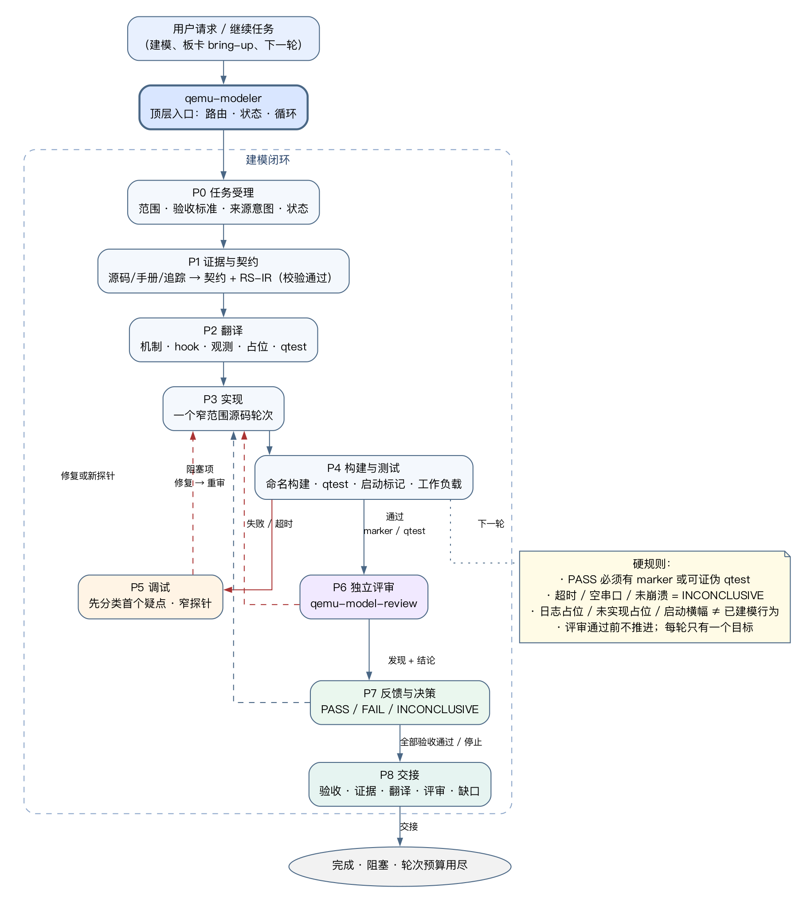

# 建模流程

> **中文** · [English](../en/modeling-workflow.md)

本文描述当前 **qemu-modeler** 驱动的端到端建模流程：从用户请求开始，经过证据、
RS-IR 翻译、实现、构建测试、调试、独立评审、反馈决策，直到交接或下一轮。



## 入口

- 用户说“建模 <设备/板卡>”“bring-up”“继续下一轮”时，从 `qemu-modeler` 开始。
- 只想做单点任务时，可以直接调用领域 skill；`qemu-workflow` 仍提供跨领域规则。
- 如果命名/需要的 skill 未安装：在 `audit.md` 记录 `missing skill: <name>`，
  用最近可用规则继续，不即兴复制、不假装使用。

## 目标模式：完成 Goal，而不是完成 Round

复杂的 QEMU 建模任务不能以“跑完 Round 0/1/2”作为完成。qemu-modeler 的默认
模式是 **goal mode**：

| 层级 | 回答的问题 | 要求 |
| --- | --- | --- |
| Goal | 用户真正要的最终状态是什么 | 可观察的 end state，不是“完成 N 轮” |
| Milestone | 哪个检查点解锁下一阶段 | 2-5 个，带 exit gate；不是任务清单 |
| Acceptance criterion | 哪个可证伪事实证明目标达成 | 每条 AC 都绑定证据（qtest/marker/trace/log） |
| Round | 现在最小的一步是什么 | 一个目标；必须对应某条 AC |

完成判定是 **goal-level**：所有 AC 都有 evidence-backed PASS、所有 milestone
都 done、没有未解决 BLOCKER，才运行 loop-state.sh loop 得到
"PASS goal complete"。否则它输出 "CONTINUE"，agent 应继续下一轮，而不是停下来
问“是否继续”。

<pre>
loop-state.sh goal &lt;task&gt; "&lt;goal&gt;" goal
loop-state.sh milestone add &lt;task&gt; M1 "&lt;checkpoint&gt;"
loop-state.sh ac add &lt;task&gt; AC1 "&lt;observable outcome&gt;"
loop-state.sh ac status &lt;task&gt; AC1 pass "&lt;evidence&gt;"
loop-state.sh milestone status &lt;task&gt; M1 done "&lt;exit-gate-evidence&gt;"
loop-state.sh loop &lt;task&gt;          # CONTINUE 或 PASS goal complete
loop-state.sh finding resolve &lt;task&gt; F-01   # 修复并重审后解除 BLOCKER
</pre>

milestone done 必须带 exit gate/evidence；修改 AC/milestone、evidence 或 blocker
finding 会重置 review status，之后要重新记录 review verdict。loop 在 round mode 只认本轮自己的
round-result，且要求有效 verdict/gate/evidence 与该轮的 review verdict 已记录
（用 round baseline 防止历史结果提前触发 handoff）。review 默认按
intermediate contract 检查；只有声明 goal complete 时才用
review-checks.sh --final-goal。

Round budget 是设计检查点，不是停止条件：到点后总结已证明/未完成项、重排
1-3 轮并继续。只有 AC 全部有证据、范围完成、外部输入/授权缺失、用户明确停止
或越过 provenance 边界时，才停止。

## 阶段 P0-P8

| 阶段 | 目标 | 关键动作 | 退出条件 |
| --- | --- | --- | --- |
| P0 任务受理 | 冻结任务与目标契约 | 分类任务、范围、验收标准、provenance 意图、允许路径、停止条件；读上一轮 state | `audit.md` baseline/goal/milestones/AC/stop condition 已记录 |
| P1 证据与契约 | 拿到有来源的事实 | 读 driver/TRM/SVD/DTB/trace；抽取 register/board/boot 事实；产出 `register-contract.md` + `register-semantics.ir` | 契约存在；unknowns/conflicts 可见；RS-IR 校验通过 |
| P2 翻译 | 把契约变成实现清单 | `--translate` 得到 mechanism/hook/observe/placeholder/qtest；确定 RegisterInfo/manual MMIO/Unimplemented Device、trace/log/error | 每条 rule 有机制+hook+qtest；guest-visible 有 observe；unimplemented 有 placeholder |
| P3 实现 | 推进一个窄目标 | 由领域 skill 实现一个 coherent change；只改请求范围内 source；更新 audit/commands | source 改动完成；无无关改动；测试/qtest 计划就绪 |
| P4 构建与测试 | 得到可判定证据 | 命名构建、窄 qtest、boot marker、workload；捕获决定性日志 | gate 结果、命令、日志路径已记录 |
| P5 调试 | 定位首个失败点 | 先分类：环境/陈旧输入/命令或 ABI/拓扑/设备语义/TCG/guest；必要时用 qemu-debug | 首个 suspect 和下一窄检查明确 |
| P6 独立评审 | 防止自证 | qemu-model-review 只看 packet，出 findings + verdict | verdict + findings 已记录；BLOCKER 列出 |
| P7 反馈与决策 | 决定下一步 | 修 blocker、重审、记录 reusable feedback、决定继续/重规划/停止 | next action 已记录；AC 状态更新 |
| P8 交接 | 可复现地结束 | 汇总 AC、证据、翻译、评审、source changes、gaps、next action | 交接报告完整；没有隐藏 blocker |

## RegisterInfo 框架决策

外设的 guest-visible control/status bank 默认使用 **RegisterInfo**。manual MMIO
只用于 command/FIFO/DMA/timing/reentrancy 等 RegisterInfo hooks 难以表达的结构，
或采用 hybrid split（control/status 用 RegisterInfo，data/command aperture 用
MemoryRegionOps）。

- 邻近设备大量使用 manual MMIO 不是充分理由；必须是同子系统、持续维护、语义可比
  的约定，并引用具体 file:line。
- 时间、预算、寄存器数量、"每个寄存器都有 side effect" 都不是决定性理由。
- 决策记录写到 output/framework-decision.md，包含 bank kind、decisive input、
  structural reason、hybrid split、accepted limits；缺失或含糊的记录是 review
  BLOCKER。
- 用 qemu-peripheral-modeling 的 check-framework-decision.sh 做确定性检查。

## 源码注释卫生

QEMU 文件头只保留 SPDX/copyright 加最多一行硬件标识；只给关键代码加 1-3 行
简短注释，最多引用一个公共来源。不要把引用扩展成 contract 摘要、寄存器表、
设计长文或过程记录：

- 不写实现策略、framework 选择/辩护、"modeled contract" 指针、邻近设备惯例理由；
- 不写过程信息：round、milestone、AC 状态、audit/review/finding、命令、进度；
- 不写 `.oh-my-qemu/...`、`output/...`、`audit.md`、evidence 路径、round/review
  ID、绝对主机路径；
- 不写 "contract is output/register-contracts-r2.md" 这类任务内引用；
- 证据和来源留在 audit/contract/output 中，源码注释要能脱离本地工作区独立阅读；
- review 时把泄漏的本地路径视为 blocker；如安装 qemu-workflow，对改动源码运行
  `gates.sh source-comments <files...>`。

## 轮次（round loop）

一个轮次 = 一个目标 + 一个门禁 + 一次独立评审 + 一个决策。
轮次是进度单位，不是目标；完成与否以 goal 的 AC/milestone 检查为准。

### 1. 写目标

在选择改动前，把最小目标写进 `audit.md`：它推进哪条 AC、消除哪类失败。
不要在一轮里混入无关 cleanup 或跨阶段阻塞项。

### 2. 执行与门禁

- 最小可逆改动或诊断探针；
- 命名构建目录 `builds/build-<target>/`；
- 最窄门禁：目标构建 → qtest → boot marker → workload；
- 记录 exact command、exit/process status、marker status、日志路径；
- PASS 只来自配置 marker 或可证伪 qtest；超时/空串口/未崩溃 = INCONCLUSIVE。

### 3. 写 round-result

```text
Round: <n>
Objective: <一个目标>
Verdict: PASS | FAIL | INCONCLUSIVE
Gate: <marker/test/命令 + 期望值>
Evidence: logs/..., output/..., tests/...
Changed paths: <本任务路径>
Commands: <有效命令>
Findings: <review ID 或 none>
Next blocker: <具体下一步或 none>
```

### 4. 独立评审

- 把 plan/AC、精确 diff、contract/RS-IR/translation、commands/logs/tests、
  round-result 打包给 `qemu-model-review`；
- reviewer 只读，不改代码；输出 BLOCKER/MAJOR/MINOR/NOTE + PASS/FAIL/INCONCLUSIVE；
- intermediate round 的 PASS 需要本轮目标/门禁有证据且本轮无 blocker，后续 AC/milestone 可以仍 pending；final-goal PASS 才要求所有 AC 有证据、所有 milestone 都 evidence-backed done，并用 review-checks.sh --final-goal 检查。INCONCLUSIVE 要说明缺什么证据、下一窄命令。

### 5. 决策

| 情况 | 下一步 |
| --- | --- |
| AC 全部有证据 | 运行 loop-state.sh loop；PASS goal complete 才 handoff，否则进入下一 AC/轮 |
| 目标达成但 AC 未全 | 计划下一窄目标并自动开始下一轮，留在同一 phase |
| 单一 blocker | 留在本轮，修复后重跑 gate |
| 证据不足 | 加探针/qtest/trace，不要先改模型 |
| 两个独立 blocker / 新阶段 | replan，拆轮次，更新 plan/state，继续 goal loop |
| 外部输入/授权缺失 | 停止并明确 blocked 条件 |
| 预算/检查点到达 | 总结已证明/未完成项，重排 1-3 轮并继续，不当作完成 |
| 用户明确停止 | 交接当前状态，标记 user-stopped，不是 goal complete |

## 调试入口

失败时先分类，再决定是否改模型：

1. 输入错误/陈旧（image、DTB、firmware、kernel、rootfs）；
2. 命令、machine option、boot ABI 不匹配；
3. host/toolchain/build dir；
4. 板卡拓扑/IRQ wiring；
5. 设备寄存器/IRQ/timer/DMA 语义；
6. TCG frontend/backend；
7. guest/rootfs/application。

debug 会话本身不是 PASS 证据；修完后必须回到 P4，用命名 gate 重新证明。

## 停止条件与交接

只有满足以下条件才停止：

- 所有 AC 有 fresh evidence-backed PASS、所有 milestone 都 evidence-backed done，当前 review status PASS，且最近 verdict 属于当前 round 并为 PASS（goal complete）；
- 用户请求范围完成，并明确 handoff；
- 外部输入/授权缺失（记录 blocked）；
- 用户明确 stop signal；
- 继续会违反 provenance 边界。

轮次预算、失败轮次、长日志都不是停止条件：重排并继续 goal loop。完成是
goal-level，不是 round-level。

交接内容：task/build 目录、goal 与 AC 状态、milestone 状态、translation 映射、
review verdict/findings、evidence 路径、source changes、pre-existing changes、
policy limits、unresolved gaps。INCONCLUSIVE 的交接必须写清楚缺什么证据和
下一窄命令，并且不等同于 goal complete。

## 硬规则

- PASS 必须有 marker 或可证伪 qtest；
- 超时、空串口、未崩溃都不是 PASS；
- logging sink / unimplemented placeholder / boot banner ≠ modeled behavior；
- 评审通过前不推进；每轮一个目标；
- 轮次数量不是目标：所有 AC 有证据且所有 milestone done 才算完成；
- 不因 Round 0/1/2 或预算到达而停止/询问；loop 输出 CONTINUE 就继续；
- 不自行 commit/push，除非用户明确要求；
- 本地-only 工作不能意外变成 upstream-ready。

## 常用命令

```bash
# 初始化/查看任务状态
bash skills/qemu-modeler/scripts/loop-state.sh init .oh-my-qemu/<task-slug>
bash skills/qemu-modeler/scripts/loop-state.sh goal .oh-my-qemu/<task-slug> "<goal>" goal
bash skills/qemu-modeler/scripts/loop-state.sh milestone add .oh-my-qemu/<task-slug> M1 "<checkpoint>"
bash skills/qemu-modeler/scripts/loop-state.sh ac add .oh-my-qemu/<task-slug> AC1 "<observable outcome>"
bash skills/qemu-modeler/scripts/loop-state.sh loop .oh-my-qemu/<task-slug>
bash skills/qemu-modeler/scripts/loop-state.sh show .oh-my-qemu/<task-slug>

# RS-IR
python3 skills/qemu-register-extraction/scripts/validate_register_ir.py \
    .oh-my-qemu/<task-slug>/output/register-semantics.ir
python3 skills/qemu-register-extraction/scripts/validate_register_ir.py --translate \
    .oh-my-qemu/<task-slug>/output/register-semantics.ir

# 工作区/轮次/交接门禁（如安装了 qemu-workflow）
bash skills/qemu-workflow/scripts/gates.sh all .oh-my-qemu/<task-slug>

# 评审 packet 的确定性检查
bash skills/qemu-model-review/scripts/review-checks.sh \
    --task-dir .oh-my-qemu/<task-slug> \
    --ir .oh-my-qemu/<task-slug>/output/register-semantics.ir \
    --validator skills/qemu-register-extraction/scripts/validate_register_ir.py
```

## 一个虚构示例（demo timer）

1. **P0**：用户要求“建模 demo timer，验收是周期中断能触发”。
2. **P1**：从 driver/TRM 抽 CTRL/EN/MODE、PERIOD、counter、irq0，产出 contract + RS-IR。
3. **P2**：`--translate` 得到 R1 → RegisterInfo/post_write、R2 → manual timer callback；
   observe 指定 `demo_timer.r1/r2`，UNMODELED_WINDOW 标记为 board_unimpl 占位。
4. **P3**：实现 CTRL 寄存器与 timer callback；board 侧先放 Unimplemented Device 占位。
5. **P4**：构建 + qtest 校验写 CTRL 后 timer 调度、到期后 counter/irq。
6. **P5**：如果 boot 卡住，先确认 image/DTB/命令，再决定是否改模型。
7. **P6**：review 发现 R2 缺 trace；判定 BLOCKER。
8. **P7**：补 trace 后 re-review PASS；移除 UNMODELED_WINDOW 占位；进入 P8。
9. **P8**：交接 AC 状态、证据路径、review 结论和剩余 gap。

## 相关文档

- [architecture.md](architecture.md)
- [rs-ir-and-translation.md](rs-ir-and-translation.md)
- `skills/qemu-modeler/SKILL.md`、`skills/qemu-model-review/SKILL.md`
- `skills/qemu-peripheral-modeling/references/ir-to-registerinfo.md`
- `skills/qemu-board-modeling/references/unimplemented-device.md`
